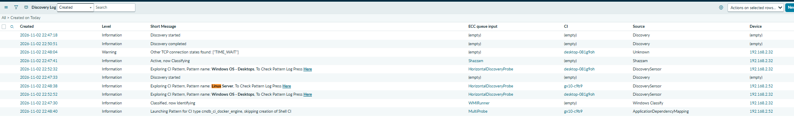
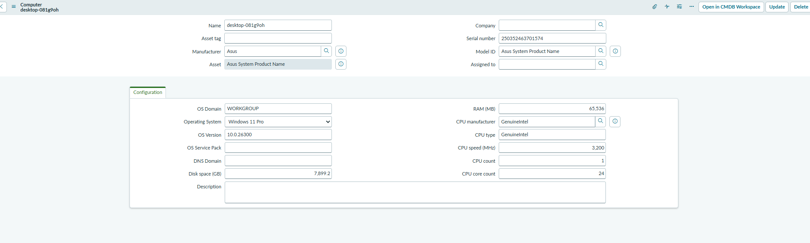
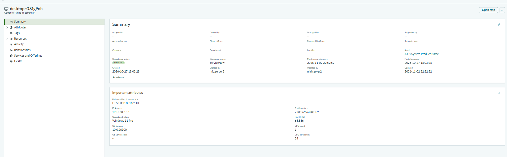
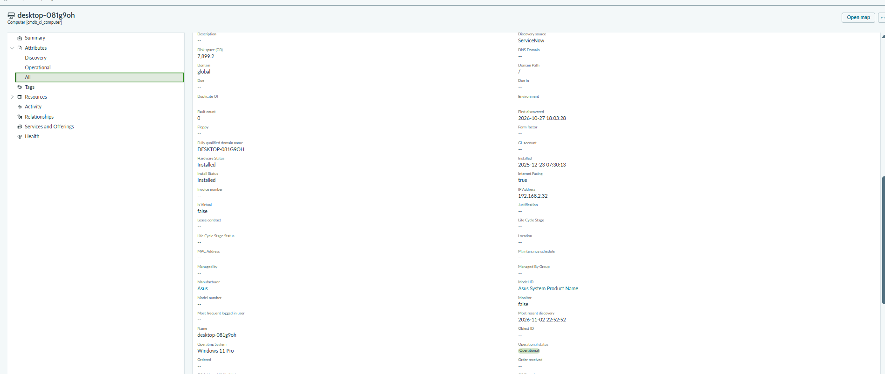
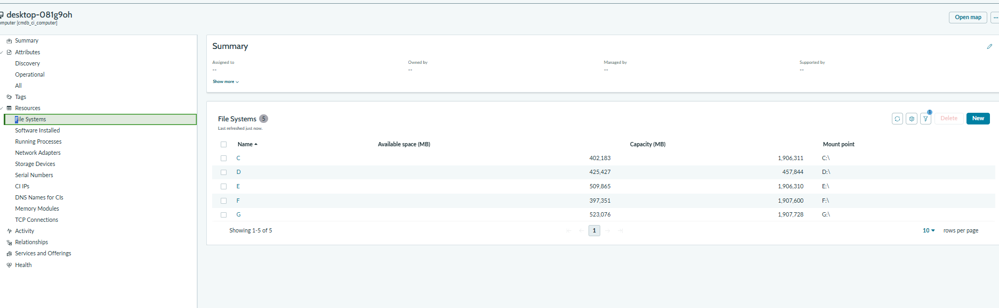
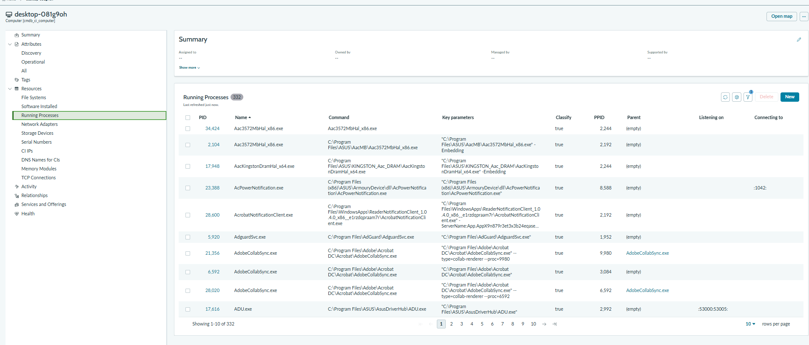
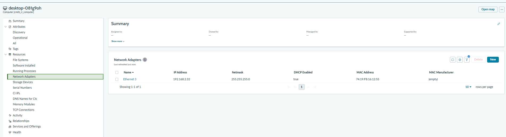
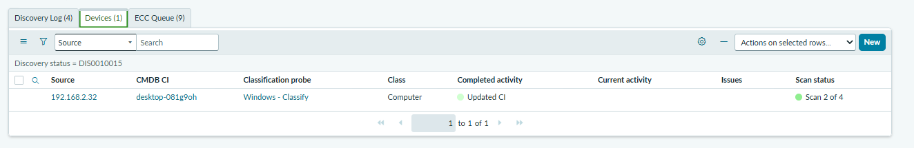
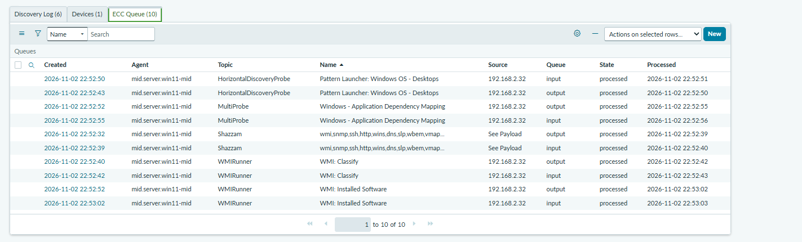
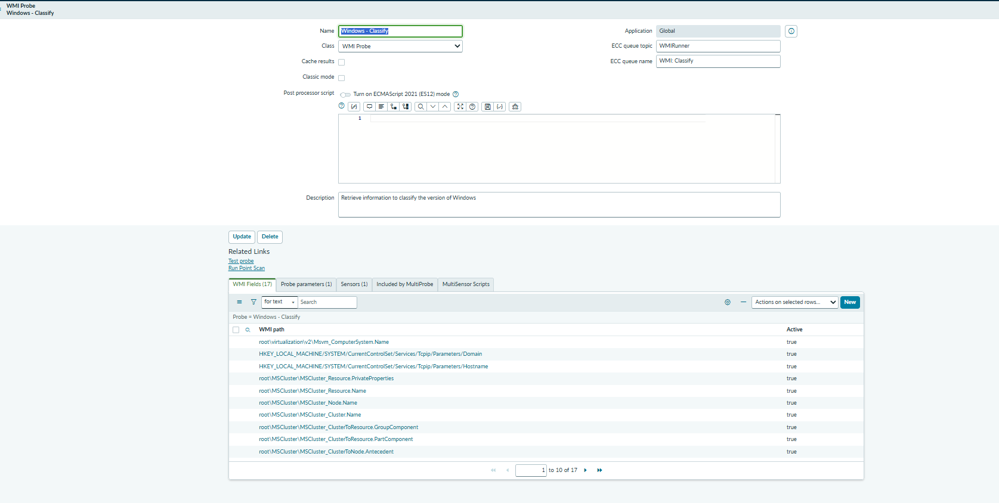

# ServiceNow Quick Discovery

A practical walkthrough of **Quick Discovery** against a small home/lab network using two MID Servers:

- **Windows MID** (`mid.server.win11-mid`) — running on Windows 11 (with workarounds)
- **Linux MID** (`gx10-mid`) — running on an ASUS GX10 / Ubuntu (with workarounds)

Quick Discovery targets a single known IP (or a small list). Full Discovery can scan IP ranges or entire subnets.

---

## What we ran

| MID Server | Host | What it can normally discover | What we actually ran |
|---|---|---|---|
| `mid.server.win11-mid` | Windows 11 | Windows + Linux | Quick Discovery of a Windows desktop (`192.168.2.32`) |
| `gx10-mid` | Linux (ASUS GX10) | Linux only | Quick Discovery of Linux targets |

**Result for the Windows run:** one Computer CI created/updated (`desktop-081g9oh`).

---

## Discovery Log (2026-11-02)

Sample entries from the Discovery Log filtered to “Created on Today”:

| Time | Level | Short Message | Device |
|---|---|---|---|
| 22:47:18 | Information | Discovery started | — |
| 22:50:51 | Information | Discovery completed | — |
| 22:48:04 | Warning | Other TCP connection states found: ["TIME_WAIT"] | 192.168.2.32 |
| 22:47:41 | Information | Active, now Classifying | desktop-081g9oh |
| 22:52:32 | Information | Exploring CI Pattern, Pattern name: **Windows OS - Desktops** | desktop-081g9oh |
| 22:48:33 | Information | Exploring CI Pattern, Pattern name: **Linux Server** | gx10-c9b9 |
| 22:52:52 | Information | Exploring CI Pattern, Pattern name: **Windows OS - Desktops** | desktop-081g9oh |
| 22:47:30 | Information | Classified, now Identifying | 192.168.2.32 |
| 22:48:40 | Information | Launching Pattern for CI type cmdb_ci_docker_engine, skipping creation of Shell CI | gx10-c9b9 |



Key observations:
- The Windows desktop (`desktop-081g9oh` / `192.168.2.32`) was classified via WMI and then explored with the **Windows OS - Desktops** pattern.
- The Linux MID host (`gx10-c9b9` / `192.168.2.52`) triggered the **Linux Server** pattern.
- A warning about TCP `TIME_WAIT` connections appeared during the scan of the Windows desktop (common and usually harmless).

---

## Final asset data (Windows desktop)

After Quick Discovery finished, the CI looked like this:

- **Name:** `desktop-081g9oh`
- **Manufacturer:** Asus
- **Serial number:** `250352463701574`
- **Operating System:** Windows 11 Pro
- **OS Version:** `10.0.26300`
- **OS Domain:** WORKGROUP
- **RAM:** 65,536 MB
- **CPU:** GenuineIntel, 3,200 MHz, 1 CPU, 24 cores
- **Disk space:** 7,899.2 GB
- **IP Address:** `192.168.2.32`
- **FQDN:** `DESKTOP-081G9OH`
- **Discovery source:** ServiceNow
- **Most recent discovery:** 2026-11-02 22:52:52

### Classic form view



### CMDB Workspace — Summary



### CMDB Workspace — Attributes (All)



### CMDB Workspace — File Systems

Discovered drives on the desktop:

| Drive | Available (MB) | Capacity (MB) | Mount |
|---|---|---|---|
| C | 402,183 | 1,906,311 | C:\ |
| D | 425,427 | 457,844 | D:\ |
| E | 509,865 | 1,906,310 | E:\ |
| F | 397,351 | 1,907,600 | F:\ |
| G | 523,076 | 1,907,728 | G:\ |



### CMDB Workspace — Running Processes

Discovery captured 332 running processes (sample shown below).



### CMDB Workspace — Network Adapters

- **Name:** Ethernet 3
- **IP Address:** `192.168.2.32`
- **Netmask:** `255.255.255.0`
- **DHCP Enabled:** true
- **MAC Address:** `74:19:F8:16:12:55`



---

## Discovery Status, Devices, and ECC Queue

On the Discovery Status record you see three related lists:

- **Discovery Log** — high-level messages
- **Devices** — CIs that were created or updated
- **ECC Queue** — the actual probe traffic (input/output) between the instance and the MID





The ECC Queue for this run shows `mid.server.win11-mid` executing:

- `HorizontalDiscoveryProbe` / Pattern Launcher: Windows OS - Desktops
- `Shazzam` (port scan)
- `WMIRunner` / WMI: Classify
- `WMIRunner` / WMI: Installed Software
- MultiProbe for Application Dependency Mapping

---

## Windows Classify probe

The classification step that identified the machine as Windows used the **Windows - Classify** WMI Probe.

It reads a set of WMI paths and registry keys (ComputerSystem, Win32_OperatingSystem, etc.) to decide the class and OS.



---

## MID Server capabilities — Windows vs Linux vs Mac

| MID Server OS | Can discover Windows | Can discover Linux | Can discover macOS | Notes |
|---|---|---|---|---|
| **Windows** | Yes (WMI) | Yes (SSH) | Limited / not out-of-box | Best general-purpose MID for mixed environments |
| **Linux** | No | Yes (SSH) | Limited | Cannot run WMI probes |
| **macOS** | No | Yes (SSH) | Yes (with credentials) | Rare as a MID host |

**In practice:**
- A Windows MID is the most flexible for a mixed lab.
- A Linux MID is sufficient (and often preferred) for pure Linux estates.
- Discovering a Mac normally requires SSH credentials and a Linux-capable MID (or a Windows MID that can also speak SSH). There is no native WMI-style probe for macOS.

---

## Can you discover many machines without Quick Discovery one-by-one?

**Yes.** Quick Discovery is intentionally limited to known IPs. For a subnet (or a list of 10 laptops) you use a **Discovery Schedule** with an IP range or a list of IPs.

**How:**

1. Go to **Discovery → Discovery Schedules → New**
2. Set the MID Server (or leave blank to let the system choose)
3. Under **IP Ranges** (or **Discover**), add something like:
   - `192.168.2.0/24` (entire subnet)
   - or a comma-separated list: `192.168.2.32,192.168.2.45,...`
4. Choose the schedule type (e.g. **Configuration Item** or **IP Range**)
5. Activate and either wait for the schedule or click **Discover now**

**What the result looks like:**
- One Discovery Status record
- Multiple rows in the **Devices** related list (one per responsive host)
- ECC Queue entries for every probe that ran against each IP
- CIs created/updated in the CMDB for each machine that responded and could be classified

You do **not** need to run Quick Discovery 10 separate times.

---

## What can be discovered without being “on” the device?

Discovery does not install an agent on the target. It uses:

- **Port scans** (Shazzam) — sees open ports (22, 135, 161, etc.)
- **WMI** (Windows MID only) — pulls OS, hardware, software if credentials are valid
- **SSH** (Linux/Mac) — runs commands or scripts if credentials are valid
- **SNMP** — for network devices
- **Pattern-based horizontal discovery** — follows relationships once a CI is identified

If the host is off, firewalled, or has no valid credentials, you may still see it as an IP with open ports, but you will not get a rich CI (OS, serial, installed software, etc.).

---

## Reporting on Discovery per MID Server

Useful places:

- **Discovery Status** list — filter by `Mid server` or look at the agent that appears in the ECC Queue
- **ECC Queue** — filter where `Agent` = `mid.server.win11-mid` (or your Linux MID)
- **Discovery Log** on a status record
- Reports on `discovery_status` or `ecc_queue` grouped by agent

Example filter on ECC Queue:
```
agent=mid.server.win11-mid^state=processed
```

---

## What determines which pattern / probe runs?

It is **not** simply “the type of MID Server.”

The decision is driven by:

1. **Open ports** found by the Shazzam (port) scan
2. **Credentials** available to the MID for that target
3. **Classification probes** that succeed (e.g. Windows - Classify via WMI, or Linux classification via SSH)
4. **Patterns** that match the classified CI class

A Windows MID can run WMI probes. A Linux MID cannot. But even a Windows MID will only run the Windows classification pattern if WMI responds and credentials work. If only SSH is open and credentials exist, it can still discover Linux boxes.

---

## Screenshots

All screenshots referenced above live in the `images/` folder of this repository. To display them:

1. Create an `images/` folder in the repo (if it does not exist).
2. Upload the PNG files with the exact names used in the markdown above (including `discovery-log-today.png`).
3. Commit and push.

Alternatively, drag the images into the README editor on GitHub and it will generate `user-attachments` URLs automatically.

---

## Related

- MID Server setup (including the Windows 11 and GX10 workarounds): [ServiceNowMidServer](https://github.com/eltonaguiar/ServiceNowMidServer)
- Portfolio overview: [servicenow_portfolio](https://github.com/eltonaguiar/servicenow_portfolio)
